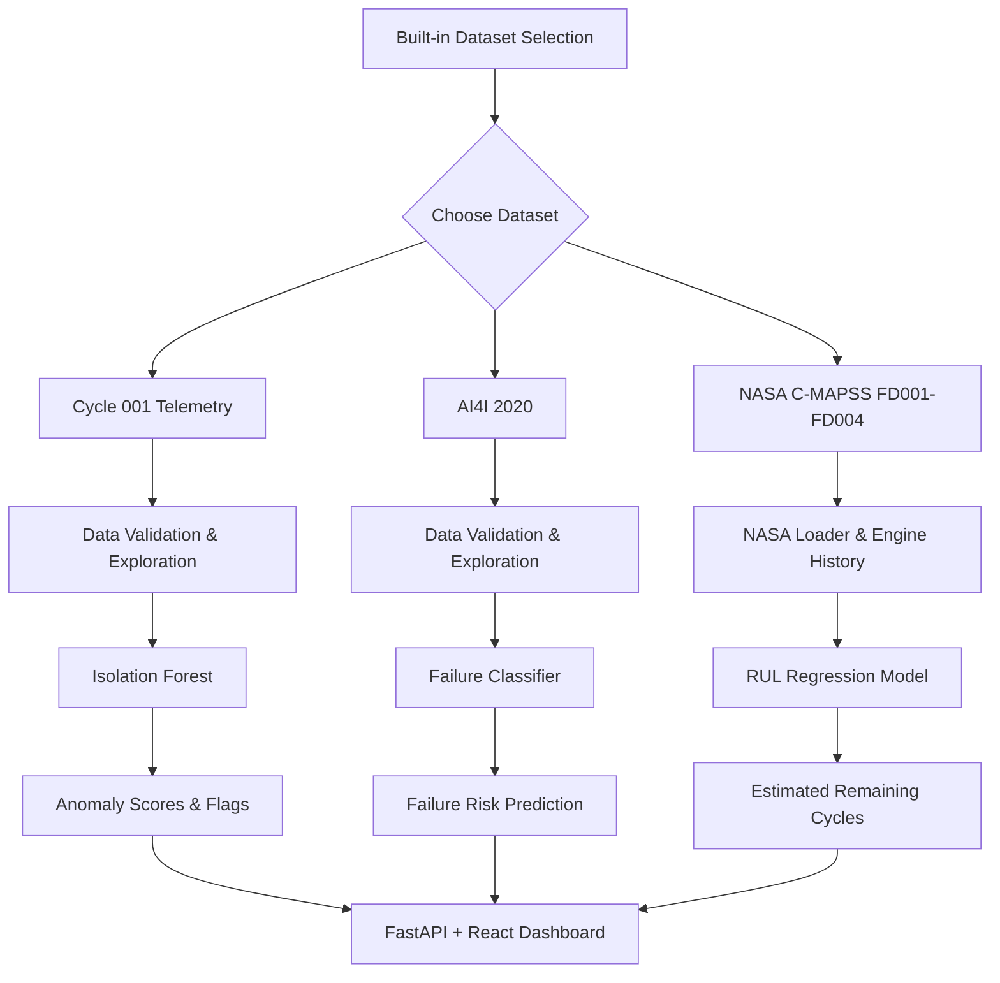

<div align="center">


<p>
  
</p>

<p>
  
  
  
</p>

<p>
  <a href="#-overview">Overview</a> •
  <a href="#-features">Features</a> •
  <a href="#-datasets--ml-workflows">Datasets & Models</a> •
  <a href="#-architecture">Architecture</a> •
  <a href="#-getting-started">Setup</a> •
  <a href="#-prepared-by">Contact</a>
</p>

</div>

---

## 🔍 Overview

**PredictIQ** is an AI/ML-powered predictive maintenance dashboard built to explore industrial telemetry, flag unusual machine behavior, predict failure risk, and estimate **Remaining Useful Life (RUL)** from benchmark datasets.

The project brings three distinct ML workflows into one dashboard. Each dataset is routed only to its compatible pipeline, keeping data schemas, targets, and model artifacts separate.

> [!IMPORTANT]
> PredictIQ is an internship/research demonstration using offline datasets. It is not connected to live factory equipment, and its outputs are not guarantees of failure prevention or real-world maintenance timing.

## ✨ Features

<table>
  <tr>
    <td width="50%">
      <h3>📡 Anomaly Monitoring</h3>
      Uses an Isolation Forest baseline to flag unusual Cycle 001 telemetry patterns for further investigation.
    </td>
    <td width="50%">
      <h3>🛠️ Failure Prediction</h3>
      Uses the labelled AI4I 2020 dataset for supervised machine-failure classification.
    </td>
  </tr>
  <tr>
    <td width="50%">
      <h3>⏳ Remaining Useful Life</h3>
      Provides a separate NASA C-MAPSS regression workflow to estimate remaining engine cycles.
    </td>
    <td width="50%">
      <h3>🔬 Dataset Explorer</h3>
      Explore dataset dimensions, schemas, missing values, previews, numeric summaries, engine histories, and sensor trends.
    </td>
  </tr>
  <tr>
    <td width="50%">
      <h3>📊 Model Evaluation</h3>
      Review applicable metrics and offline benchmark results without confusing anomaly scores with confirmed failures.
    </td>
    <td width="50%">
      <h3>⚡ Responsive Dashboard</h3>
      React-based screens with loading and error states, shared dataset selection, and reduced-motion-aware UI animations.
    </td>
  </tr>
</table>

## 🧰 Tech Stack

<div align="center">


<br/><br/>


</div>

- **Data & ML:** pandas, NumPy, scikit-learn
- **Backend:** Python, FastAPI, Pydantic
- **Frontend:** React, TypeScript, Vite, Tailwind CSS, Recharts
- **Quality:** automated backend/frontend tests, TypeScript checks, production build

## 🗂️ Datasets & ML Workflows

| Dataset | Purpose | Workflow | Important note |
|---|---|---|---|
| Cycle 001 machine telemetry | Unlabelled sensor/telemetry exploration | Isolation Forest anomaly detection | Anomalies are unusual patterns, not confirmed failures. |
| AI4I 2020 Predictive Maintenance | Labelled machine failure data | Supervised classification | Uses the dataset's supported features and labels. |
| NASA C-MAPSS FD001–FD004 | Simulated engine degradation sequences | Remaining Useful Life regression | Each subset uses a dedicated NASA-compatible data pipeline. |

### NASA C-MAPSS

The NASA loader validates the expected **26 fields**: engine ID, cycle, three operational settings, and 21 sensor measurements. Training, test, and official RUL label files are kept separate.

The RUL baseline uses training trajectories to construct cycle-based targets and holds out whole engines for validation to reduce engine-level leakage. Official test RUL labels are reserved for evaluation, not model fitting or tuning.

> Metrics are dataset- and split-dependent. Treat them as offline benchmark estimates, not evidence of validated live-machine performance.

## 🧠 How It Works



## 🏗️ Architecture

```text
PredictIQ/
├── app.py                    # FastAPI application entry point (if applicable)
├── api/                      # API modules, routes, and schemas (project-dependent)
├── backend/                  # Backend code (if present in this repository)
├── scripts/                  # Training/evaluation scripts (if present)
├── docs/
│   └── nasa_cmaps/           # NASA C-MAPSS files, if included locally
├── src/                      # React + TypeScript dashboard (if present)
├── tests/                    # Automated tests (location may vary)
├── README.md
└── package.json
```

> This is a conceptual guide to common project areas, not a guarantee that every listed folder exists in your current checkout. Keep this tree aligned with the actual repository before publishing.

## 🚀 Getting Started

### Prerequisites

- Python 3.10+ recommended; use the version specified by your project configuration if different.
- Node.js and npm compatible with the project's Vite version.
- Git.

### 1. Clone the repository

```bash
git clone https://github.com/muzammilkhaliq7894-ui/PredictIQ-.git
cd <PredictIQ->
```

### 2. Set up the Python environment

**Windows PowerShell**

```powershell
python -m venv .venv
.\.venv\Scripts\Activate.ps1
pip install -r requirements.txt
```

If your repository does not contain `requirements.txt`, use the dependency file and installation instructions actually provided by your project. Do not create a requirements file by guessing.

### 3. Start the backend

Use the startup command documented by the project. For example, if the FastAPI app is exposed as `api.app:create_app`, the command may be:

```powershell
uvicorn api.app:create_app --factory --reload --host 127.0.0.1 --port 8011
```

If your current application uses a different module path or app factory, replace this example with the verified command from your repository.

### 4. Start the frontend

Open a second terminal in the frontend/project directory:

```bash
npm install
npm run dev
```

Open the local URL printed by Vite. Ensure the frontend's configured API base URL matches the backend address and port.

### 5. Run checks

Use the commands defined by your repository's `package.json` and Python test configuration. Common examples are:

```bash
npm test
npm run typecheck
npm run build
python -m pytest
```

> Script names vary by project. Check `package.json` and the repository's test configuration before running these commands.

## 📈 Evaluation Metrics

Use metrics appropriate to each workflow:

- **Anomaly detection:** review anomaly flags and score distributions; without verified labels, do not present them as accuracy or confirmed failure rates.
- **Failure classification:** precision, recall, F1, average precision, and the confusion matrix can help assess the cost of false alarms versus missed failures.
- **RUL regression:** MAE and RMSE measure cycle prediction error; R² provides complementary context. The NASA asymmetric score penalizes late predictions differently from early predictions.

Always report the dataset subset, split strategy, and whether metrics come from validation or official test data.

## 🎞️ README Animations & Icons

This README uses externally hosted assets for visual polish:

- Animated waving header from Capsule Render
- Typing tagline from Readme Typing SVG
- Technology icons from Skill Icons
- Status and technology badges from Shields.io
- Mermaid for the workflow diagram

If an external asset service is unavailable, GitHub may display a fallback or no image. The project itself does not depend on these services to run.

## 🔐 Responsible Use & Limitations

- Built for learning, demonstration, and offline benchmark experimentation.
- Not connected to real-time industrial equipment or sensor streams.
- An anomaly is not automatically a failure.
- Model outputs are estimates and may be wrong.
- Performance can change across datasets, engines, operating conditions, and deployment environments.
- Validate models, monitor drift, and add suitable access controls before any real-world deployment.
- Do not expose an unauthenticated API publicly without appropriate security controls.

## 🗺️ Roadmap

- [x] Separate workflows for Cycle 001, AI4I 2020, and NASA C-MAPSS
- [x] Dataset exploration and model evaluation screens
- [x] Automated tests and production build checks
- [ ] Further independent model benchmarking and reproducibility review
- [ ] Deployment hardening, security review, and operational monitoring
- [ ] Live industrial data integration only after suitable validation and safeguards

## 👨‍💻 Prepared By

<div align="center">

### **Muzammil **
**ALONZA Internship Task** · AI/ML & Predictive Maintenance

<a href="mailto:muzammilkhaliq7894@gmail.com">
  
</a>

<br/>

*Built to explore how machine-learning techniques can support data-driven maintenance decisions.*

</div>

---

<div align="center">

**PredictIQ** · *From telemetry to actionable insights*


</div>
